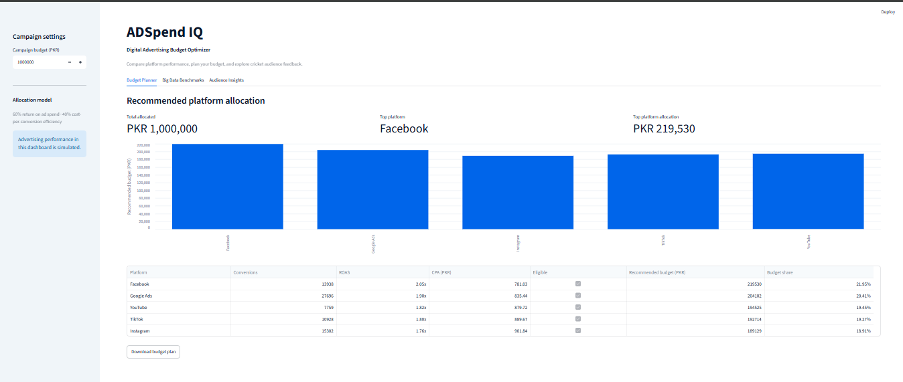
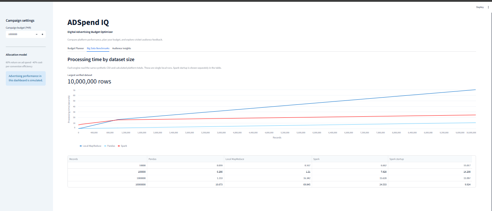
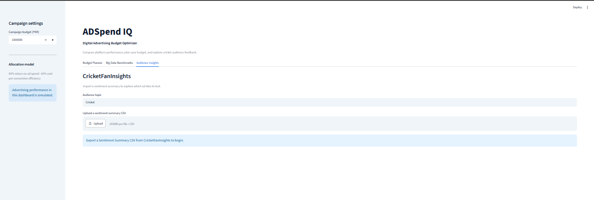

# ADSpend IQ

A Big Data Analytics project that recommends how to allocate a simulated
PKR 1,000,000 advertising budget across Facebook, Instagram, Google Ads,
TikTok, and YouTube.

## Planned work

- Generate synthetic advertising data and calculate campaign metrics.
- Compare Pandas, local MapReduce, and Spark at different dataset sizes.
- Display benchmark results and budget recommendations in Streamlit.

## Connection to Project 1

ADSpend IQ will import a sentiment summary CSV from CricketFanInsights
to suggest ad creative ideas. The budget recommendation will use
simulated advertising performance.

Project 1: https://github.com/engrmansoor304/CricketFanInsights

## Dashboard screenshots

### Budget Planner

### Big Data Benchmarks

### Audience Insights

